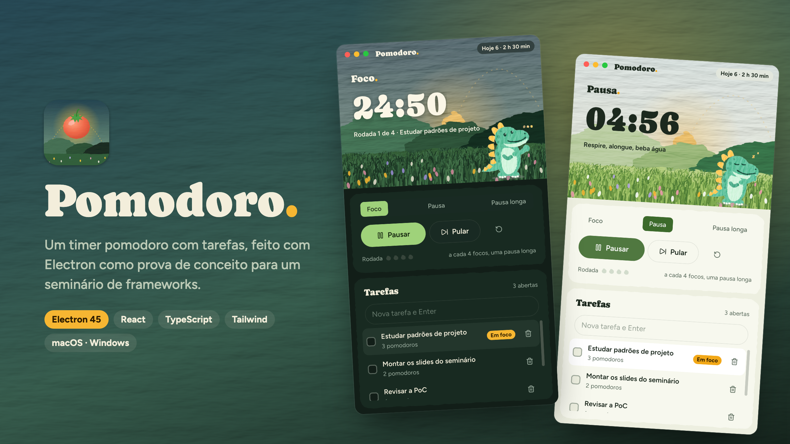
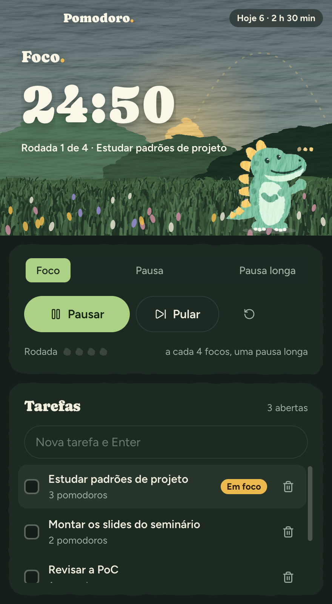
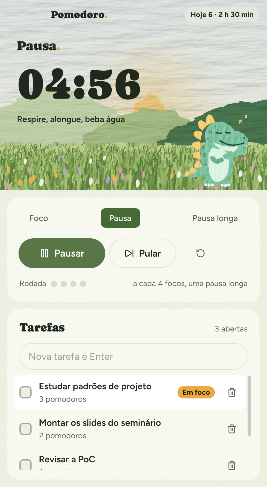
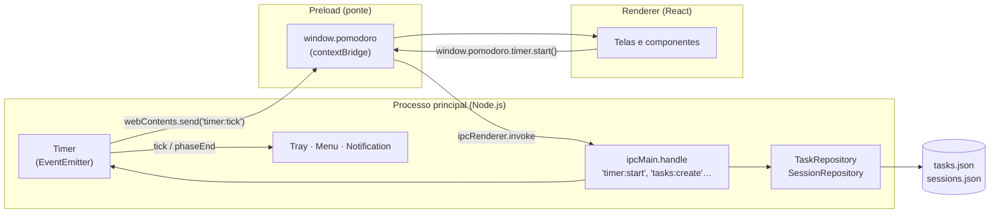
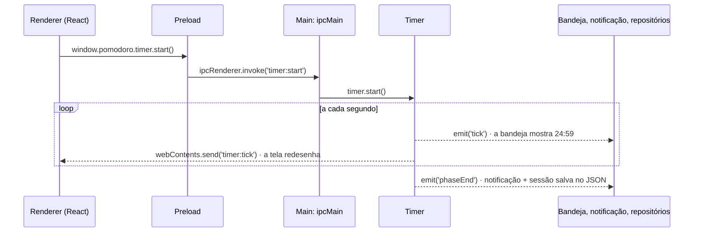

<p align="center">
  
</p>

<p align="center">
  <a href="https://github.com/Eliezir/pomodoro-electron/actions/workflows/build.yml"></a>
  
  
  <a href="LICENSE"></a>
</p>

# Pomodoro

Um timer pomodoro com tarefas para desktop, feito com **Electron**. É a prova de conceito (PoC) do seminário de frameworks da disciplina de Análise e Projeto de Sistemas de Informação do IFAL Maceió.

A ideia é mostrar, num app pequeno e de verdade, como o Electron funciona por dentro: os processos, a ponte segura entre eles, as APIs do sistema operacional e os padrões de projeto que aparecem no caminho.

## Baixar

Os instaladores ficam na página de **[Releases](https://github.com/Eliezir/pomodoro-electron/releases)**:

| Sistema               | Arquivo                            |
| --------------------- | ---------------------------------- |
| macOS (Apple Silicon) | `Pomodoro-…-mac-arm64.dmg`         |
| macOS (Intel)         | `Pomodoro-…-mac-x64.dmg`           |
| Windows               | `Pomodoro-…-windows-x64-setup.exe` |

> [!NOTE]
> Os instaladores não são assinados, então o sistema avisa na primeira vez.
>
> **macOS:** abra com o botão direito › Abrir. Se aparecer "danificado", rode `xattr -cr /Applications/Pomodoro.app`.
>
> **Windows:** no aviso do SmartScreen, clique em "Mais informações" › "Executar assim mesmo".

## Telas

<table>
  <tr>
    <td width="50%"></td>
    <td width="50%"></td>
  </tr>
  <tr>
    <td align="center">Foco em andamento, tema escuro</td>
    <td align="center">Pausa, tema claro</td>
  </tr>
</table>

O topo é uma paisagem pintada em que **o céu é o relógio**: o sol percorre o arco conforme a fase avança. O dino reage ao que está acontecendo: concentrado no foco, dormindo na pausa, chamando de volta quando você pausa e comemorando quando um foco termina.

## O que ele faz

- **Ciclo pomodoro:** foco de 25 min, pausa de 5 min e, a cada 4 focos, uma pausa longa de 15 min.
- **Tarefas:** criar, renomear (clique duplo), concluir e apagar. Clique numa tarefa para focar nela; cada foco concluído conta para ela.
- **Histórico do dia:** quantos pomodoros e quanto tempo de foco.
- **Barra de menus e bandeja:** a contagem aparece ao lado do ícone no macOS, e o menu tem iniciar, pausar, pular, escolher a fase e a tarefa.
- **Notificação** do sistema no fim de cada fase.
- **O timer continua com a janela fechada**, porque ele vive no processo principal.
- **Modo demonstração** (Timer › Modo demonstração): 20 s de foco, 5 s de pausa e 10 s de pausa longa, para apresentar o ciclo inteiro em poucos segundos.
- **Tema claro e escuro** seguindo o sistema.

## Como o Electron aparece no código

Um app Electron tem dois mundos: o **processo principal** (Node.js, um por app, cuida das janelas e do sistema) e o **renderer** (uma página web isolada por janela). O **preload** é a única ponte entre eles.



### O caminho de um clique em "Iniciar"



### APIs do Electron usadas

| API                       | Para quê                                                                                                             |
| ------------------------- | -------------------------------------------------------------------------------------------------------------------- |
| `app`                     | Ciclo de vida, instância única (`requestSingleInstanceLock`), pasta de dados (`getPath('userData')`), painel "Sobre" |
| `BrowserWindow`           | A janela de tamanho fixo, com `contextIsolation`, `sandbox` e barra de título própria                                |
| `ipcMain` / `ipcRenderer` | Comandos da tela para o main e o `tick` do main para a tela                                                          |
| `contextBridge`           | Expõe só `window.pomodoro` para a página                                                                             |
| `Tray` · `nativeImage`    | Ícone e contagem na barra de menus ou na bandeja                                                                     |
| `Menu`                    | Barra de menus em português e menu da bandeja                                                                        |
| `Notification`            | Aviso no fim de cada fase                                                                                            |
| `shell`                   | Abre os links da Ajuda no navegador                                                                                  |
| Electron Forge · Fuses    | Empacota DMG e instalador do Windows e desliga recursos inseguros no build                                           |

## Padrões de projeto

| Padrão                         | Onde                                                                                                                       | Arquivo                                                              |
| ------------------------------ | -------------------------------------------------------------------------------------------------------------------------- | -------------------------------------------------------------------- |
| **Observer**                   | O timer é um `EventEmitter`; janela, bandeja, notificações, menu e registro de sessões se inscrevem em `tick` e `phaseEnd` | [`Timer.ts`](src/main/timer/Timer.ts), [`main.ts`](src/main/main.ts) |
| **State**                      | Cada fase (Foco, Pausa, Pausa longa) é um objeto que sabe sua duração e qual fase vem depois                               | [`phases.ts`](src/main/timer/phases.ts)                              |
| **Singleton**                  | Só uma cópia do app roda; abrir de novo traz a janela que já existe                                                        | [`main.ts`](src/main/main.ts)                                        |
| **Facade + Proxy de proteção** | O preload dá à página uma API pequena e nomeada no lugar do IPC e do Node                                                  | [`preload.ts`](src/preload/preload.ts)                               |
| **Command**                    | Cada canal IPC é um comando com nome (`'timer:start'`, `'tasks:create'`) tratado por um handler                            | [`ipc/`](src/main/ipc)                                               |
| **Repository**                 | O resto do app pede tarefas e sessões por significado e nunca toca no JSON                                                 | [`repositories/`](src/main/repositories)                             |
| **Composite**                  | Os menus são árvores de itens e submenus; o mesmo trecho monta a barra de menus e a bandeja                                | [`timerItems.ts`](src/main/menus/timerItems.ts)                      |

O próprio Electron também usa esses padrões por dentro: o objeto `app` é único (`lib/browser/api/app.ts` traz o comentário _"Only one app object permitted"_), as classes nativas herdam de um `EventEmitterMixin` e `NativeWindow::Create` devolve uma janela diferente por sistema (Factory Method).

## Estrutura

```
src/
├── shared/types.ts        tipos e nomes dos canais IPC, usados pelos dois lados
├── main/                  processo principal (Node.js)
│   ├── main.ts            inicialização, instância única, quem escuta o timer
│   ├── window.ts          a janela
│   ├── timer/             Timer (Observer) e fases (State)
│   ├── repositories/      tarefas e sessões (Repository)
│   ├── storage/           JsonStore: leitura e escrita segura do JSON
│   ├── ipc/               handlers dos comandos (Command)
│   ├── menus/             barra de menus e bandeja (Composite)
│   └── notifications.ts   notificação no fim da fase
├── preload/preload.ts     window.pomodoro (Facade / Proxy)
└── renderer/              React
    ├── App.tsx
    ├── features/          TimerHero, TimerControls, TaskList
    ├── components/meadow/ cena pintada, grama, dino, filtros de pintura
    ├── components/motion/ componentes beUI
    └── hooks/             useTimer, useTasksAndStats, useDarkMode
```

## Rodando localmente

Precisa de Node.js 22 e pnpm 10.

```sh
pnpm install
pnpm start          # abre o app em modo de desenvolvimento
```

| Comando                        | Faz                                                                  |
| ------------------------------ | -------------------------------------------------------------------- |
| `pnpm start`                   | App em desenvolvimento, com recarga da interface                     |
| `pnpm make`                    | Gera os instaladores do sistema atual em `out/make`                  |
| `pnpm lint` · `pnpm typecheck` | Verificações                                                         |
| `./scripts/build-icons.sh`     | Gera `icon.png`, `.icns` e `.ico` a partir de `assets/icon/icon.svg` |

Variáveis úteis em desenvolvimento: `POMODORO_DEMO=1` começa no modo demonstração e `POMODORO_DATA_DIR=/algum/lugar` guarda os dados numa pasta separada.

## Integração contínua

A cada push na `main` e em cada pull request, o [GitHub Actions](.github/workflows/build.yml) roda lint e typecheck e gera os instaladores para **macOS Apple Silicon**, **macOS Intel** e **Windows**. Eles ficam como artefatos da execução. Ao publicar uma tag `v*` (por exemplo `v1.0.0`), os instaladores vão para uma Release.

## Tecnologias e créditos

- [Electron](https://www.electronjs.org/) 45 com [Electron Forge](https://www.electronforge.io/) e Vite
- [React](https://react.dev/) 19, TypeScript, [Tailwind CSS](https://tailwindcss.com/) 4
- Componentes animados do [beUI](https://beui.dev/) (MIT), ícones [Lucide](https://lucide.dev/)
- Visual baseado na direção **Meadow** do Done.: paisagem pintada com filtros SVG, dino mascote e fontes [Caprasimo](https://fonts.google.com/specimen/Caprasimo) e [Figtree](https://fonts.google.com/specimen/Figtree) (SIL OFL)

## Licença

[MIT](LICENSE)
